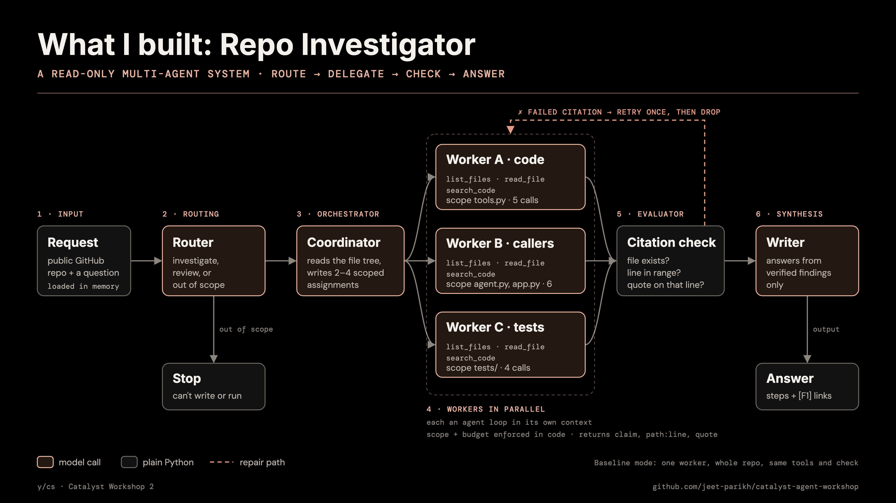

# Catalyst Agent Workshop

Two small agents you can read and run, written in plain Python with Streamlit and the OpenAI Responses API. There's no agent framework.

| | Project | What it shows |
| --- | --- | --- |
| Workshop 1 | **Movie Night Planner** | One model, two tools, one agent loop |
| Workshop 2 | **Repo Investigator** | Several agents working together on a real GitHub repo |

Both run from one app. Pick a project in the sidebar.

## Run it

You need Python 3.10 or newer.

**1. Install (once)**

```sh
python3 -m venv .venv
source .venv/bin/activate
pip install -r requirements.txt
cp .env.example .env
```

**2. Add your keys to `.env`.** Never commit this file.

| Key | Needed for | Where to get it |
| --- | --- | --- |
| `OPENAI_API_KEY` | Both | Your OpenAI account. Calls are billed there. |
| `TMDB_READ_TOKEN` | Movie Night Planner | [TMDB API settings](https://www.themoviedb.org/settings/api). Use the long **API Read Access Token**, not the short API key. |
| `GITHUB_TOKEN` | Optional | Only raises GitHub's rate limit. Public repos work without it. |

**3. Start the app**

```sh
streamlit run app.py
```

Open the URL Streamlit prints. Next time, run only `source .venv/bin/activate` and step 3.

## Project layout

```text
app.py                  one app, two pages
movie_agent/            Workshop 1
  agent.py              instructions and the agent loop
  tools.py              search_movies, get_movie_details
  page.py               chat and tool-call trace
repo_investigator/      Workshop 2
  agents.py             router, coordinator, workers, writer
  repo.py               loads a GitHub repo, read-only tools, citation check
  page.py               live run, replay, comparison
  architecture.png      the diagram below
  runs/                 saved real runs you can replay
tests/                  one test file per project
```

## Workshop 1: Movie Night Planner

**V0** sends one model request with no tools, so its picks aren't checked against anything. **V1** gives the same model two tools and a loop:

```text
You → model → tool call → Python runs it → result → model → answer
                ↑                                    |
                └────────── another call ────────────┘
```

The model decides whether to call a tool and with what arguments. Python runs the tool and sends the result back. A turn stops after eight model requests.

**Try:**
- "We want something funny or mysterious, under two hours, with no horror."
- "Actually, we already watched Game Night. Something under 105 minutes?"
- "Find a comedy under 20 minutes."

Run the same prompt in V0 and compare.

**Exercise:** add a watched-movie argument to `search_movies` in `movie_agent/tools.py`, then ask the agent to skip a title.

## Workshop 2: Repo Investigator

Give it a public GitHub repo and a question, such as "How do I add a feature?" or "Does this meet these requirements?". It answers with links to the exact lines of code. It only reads: it can't edit files, run code or open pull requests.



| Step | Pattern | What happens |
| --- | --- | --- |
| 1 · Input | | The repo is downloaded into memory. Nothing is written to disk. |
| 2 · Router | Routing | A model labels the request investigate, review or out of scope. Out of scope stops here. |
| 3 · Coordinator | Orchestrator–workers | A model reads the file list and writes 2–4 separate assignments. |
| 4 · Workers | Parallelization | Each worker is its own agent loop with its own context. Code limits which files it can read and how many tool calls it gets. |
| 5 · Citation check | Evaluator | Plain Python checks that each cited file and line exists and contains the quote. A failed citation gets one retry, then it's dropped. |
| 6 · Writer | Synthesis | A model writes the answer using only verified findings. |

**Try:**
1. Run the default question on this repo.
2. Switch to **Single agent (baseline)** in the sidebar and run the same question. A comparison table appears.
3. Paste in your own public repo.

Click **Show agent diagram** to see the picture above while it runs. Every live run is saved to `repo_investigator/runs/`, and **Replay recording** plays a saved run back without a network connection.

**Read the results carefully:**
- The citation check proves a quote really is on the cited line. It doesn't prove the worker's claim about that line is correct.
- Workers can miss files. Leaving something out isn't the same as citing something wrong.
- One run of each mode is an anecdote. Compare several questions before deciding one architecture is better.

## Tests

```sh
python -m unittest discover -s tests -v
```

The tests use a fake model, a fake TMDB and a fake GitHub, so they cost nothing.

## Links

[OpenAI function calling](https://developers.openai.com/api/docs/guides/function-calling) · [Building effective agents](https://www.anthropic.com/engineering/building-effective-agents) · [Multi-agent research system](https://www.anthropic.com/engineering/multi-agent-research-system) · [TMDB API](https://developer.themoviedb.org/reference/discover-movie)

This product uses the TMDB API but is not endorsed or certified by TMDB.
